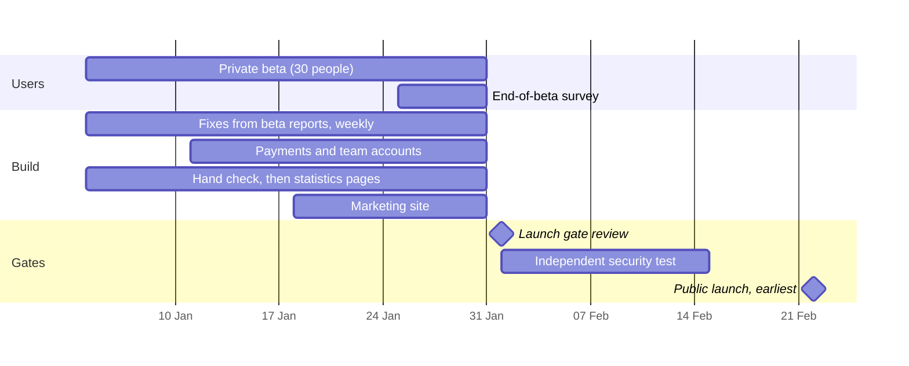

# What comes after the 11 weeks

**The next thing is the private beta: four weeks, Mon 4 Jan to Sat 30 Jan 2027.** Real
lawyers and students use the product every day, and their usage and reports decide whether
it's ready for the public. While they use it, the team builds what was moved out of the MVP:
payments, team accounts, statistics pages and the marketing site.

After the beta comes the **launch gate**: seven conditions, all of which must be true. Then
the **independent security test**. Only then the **public launch**, **February 2027 at the
earliest**. If any condition fails, the date moves.

The dates after 30 Jan are the **earliest possible**, not a promise. **Never announce a
public launch date before the gate passes.**

---

## 1. The private beta: 4 to 30 Jan

### Week 1 (4 to 9 Jan): the first real users
The plan for this week is written in Week 11 (`team/beta/week-1-plan.md`). In short:

| Every day | Who |
|---|---|
| Read the admin page: removed citations, feedback, failed uploads | Shaan |
| Answer beta users the same working day | Ranveer |
| **A reported made-up citation**: find which check missed it, write a test, fix it, **the same day** | Shaan |
| **A report of seeing someone else's data**: the breach playbook, immediately (72-hour clock) | Shaan + Akash |
| Screen bugs: triaged daily, fixed weekly | Meghna |

Plus five or six **group kickoff calls** (Ranveer, with Shaan or Meghna showing the screen).

### Every week of the beta
- **Monday:** review last week's numbers (below) and pick the fixes
- **One deploy a week**, through the workflow, after the tests. Emergencies only otherwise
- **Saturday:** standup issue and a short beta note to all 30 ("what we fixed this week")

### What the beta measures

| Measure | Why | Gate |
|---|---|---|
| Verified-citation rate, on real questions | The trust promise, outside the test set | (a) 98%+ on the test set |
| Answers with a removed citation | Is the verifier catching a lot? | (c) under 0.5% |
| **Confirmed made-up citations reaching a user** | The one failure the product can't survive | (c) **zero** |
| Questions per user per week; who comes back in week 4 | Is it actually useful? | No target yet (`docs/METRICS.md`) |
| What people ask that's out of scope | Which High Courts to add first | Phase 2 choice |
| Upload use (if on) | Do lawyers really upload? | The upload limits and warning |
| **"Would you pay ₹499 a month?"** (advocates), ₹199 (students) | The price, before payments go public | (b) **6 of 10 advocates** say yes |

### What the team builds during the beta
These were **moved out of the MVP** to fit the 11 weeks ([`../team/V1-PLAN.md`](../team/V1-PLAN.md) §1):

| Work | Owner | Note |
|---|---|---|
| **Payments** (Razorpay): Student, Pro, Chambers plans; the webhook with its signature check | Akash | Needed before the public launch, not for the free beta |
| **Chambers team accounts** (minimum 3 seats, one bill; each member's chats stay private) | Akash + Meghna | |
| **The 50-judgment Supreme Court hand check** of outcome labels, against a pass rule agreed with the advocate **before** checking | Shaan + advocate | Statistics go live only if it passes |
| **Public statistics pages**, share cards and sitemap | Meghna + Shaan | Descriptive counts only, never predictions. Behind `FEATURE_STATS_LIVE` |
| **Marketing site** | Meghna | No claims we can't prove: no user counts, logos or testimonials until they exist |
| **More knowledge notes**: limitation periods, leading cases | Shaan + Meghna, advocate review | Only where answers go wrong, driven by beta reports |
| Snapshot **v2026.08.1** and the re-embedding experiment | Shaan | Optional; only if they measurably improve search |

The beta's **feedback comes first**. If beta users find serious problems, these wait.

---

## 2. The launch gate: about Mon 1 Feb

From [`../docs/METRICS.md`](../docs/METRICS.md). **All seven** must be true:

| | Condition | Expected status by the end of the beta |
|---|---|---|
| a | Verified-citation rate **98%+** on the 200-question test set | Measured in Week 10, re-run at the end of the beta |
| b | **6 of the 10** beta advocates would pay the Pro price | The end-of-beta survey |
| c | **Zero** made-up citations reaching a beta user, and under 0.5% removed on the test set | The beta's admin page and the final re-run |
| d | The advocate's **written legal opinion** | Due 28 Nov 2026 |
| e | Voyage's **written** no-training and retention terms | Requested Oct 2026; still open if Voyage never replied |
| f | The **independent security test** passed | **Not yet**: booked for February |
| g | The **data-as-of date** shown prominently everywhere | Built into every page in the MVP |

**If any condition fails, the launch date moves.** The decision isn't softened to keep a date.

## 3. February: the security test, then the decision

- **The independent security test** (firm chosen in Week 10): the website, the API, sign-in,
  uploads with hostile files, and whether one user can reach another's data. Fix every
  serious finding, then re-test
- **The product name**, from the trademark search. Branding, the domain and the marketing
  site change only once it's cleared
- **Payments switched on**, with the prices the beta supported
- **Public launch**: February at the earliest, only once a to g all pass. Then the sign-up
  allowlist is switched off (`SIGNUP_INVITE_ONLY`), and the site is opened to search engines

## 4. After the public launch: months 4 to 6 and beyond

From [`../docs/ROADMAP.md`](../docs/ROADMAP.md) and [`../docs/PRODUCT.md`](../docs/PRODUCT.md):

| When | What | Decided by |
|---|---|---|
| Within 3 months of launch (P1) | **Hindi** (moves to the MVP if the interviews or the beta strongly ask for it) | Interviews and beta |
| Within 3 months (P1) | **Drafting, review and compare** tools (an editor and Word export) | |
| Soon after launch | **The first data refresh.** The snapshot is from August 2026, so by a February launch the law is about 6 months old. Decision D2 moved the refresh pipeline after the MVP; plan it as the first big job after launch | Shaan |
| When paying users cover the cost | **Phase 2: High Courts.** Bombay, Telangana and Kerala are the PRD's list; the interviews and the beta's out-of-scope questions decide which first | Shaan |
| When paying users cover it | A second server behind a load balancer (today there's no failover) | Shaan + Akash |
| Post-launch | Tribunals (free PDFs with no text layer, so all OCR cost) | |
| Month 6 at the earliest (P2) | Counter-arguments, moot court, study buddy. Only these might justify a framework like LangGraph, and **the verifier stays forced** | Shaan |

---

## The very next steps, in order

1. **Sat 26 Dec 2026:** Shaan wraps Month 3, updates [`../team/V1-PLAN.md`](../team/V1-PLAN.md)
   (shipped, moved, dropped) and these two files with the real numbers
2. **Sat 2 Jan:** the last check of the "Ready for the beta" list ([`../team/MONTH-3.md`](../team/MONTH-3.md))
3. **Mon 4 Jan:** the beta opens; kickoff calls start
4. **First beta week:** write the plans for beta weeks 2 to 4 (`team/WEEK-12.md` onwards),
   in the same format as Weeks 1 to 11, with GitHub issues, built from what the first week
   shows
5. **About Mon 1 Feb:** the launch gate review, all four of you
