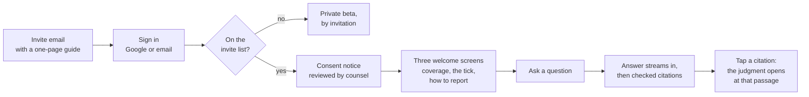
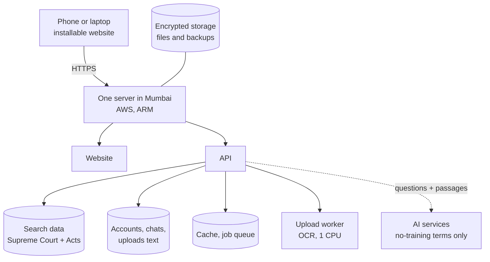

# What the product looks like on Mon 4 Jan 2027

**After 11 weeks:** an AI legal research tool that **30 invited people** (20 law students
and 10 advocates) can use for free. They ask a legal question in plain words and get a
short plain answer where **every citation has been checked against the dataset**. They can
look up any Central Act section, read full Supreme Court judgments, and (if the Week 8
go/no-go allows) ask questions about their own documents.

It's a **private beta**, not a public product: sign-up is by invitation only, nothing is
paid, and the site is hidden from search engines.

> This is the **plan**, written before Week 1. If the plan slips, the drop list in
> [`../team/V1-PLAN.md`](../team/V1-PLAN.md) §2 removes the extras first. The citation
> checks, the user-isolation tests and the 200-question test runs are never cut.

---

## A beta user's first ten minutes

---

## What a user can do

| Feature | What they see | Behind it |
|---|---|---|
| **Research chat** | A short plain answer, word by word, then the sources. Each citation has a **tick** (supports the sentence) or a **warning mark** (partly). Anything that failed a check is gone, with a note saying one authority couldn't be verified | The fixed 11-step pipeline: search, re-rank, relevance check, answer, then the **four-check citation verifier** |
| **Follow-up questions** | "And what about the next section?" works | Memory of the last 6 turns plus a summary; the question rewritten into a standalone one |
| **Act and section lookup** | Type "NI Act 138" or "BNS 103" and land on the section. Free, no sign-in needed | 22,264 Central Acts. **In-force status is shown only where the dataset has it** (1,568 Acts); the rest say "in-force status not checked" |
| **Judgment pages** | Full Supreme Court judgments, text first, paragraph links, the citation exactly as recorded, the PDF only on tap | All Supreme Court judgments in snapshot v2026.08. **No judge or party names**: those fields failed the audit |
| **Old law → new law** | Answers about IPC, CrPC or the Evidence Act also point to BNS, BNSS or BSA | Law maps, **only the rows the advocate approved** |
| **Upload and chat** | Upload a PDF, Word file or scan; ask about it; answers split into **"Your document says"** and **"Supreme Court judgments say"**, with page numbers that jump to the exact passage | OCR for scans (English and Hindi), uploads kept apart per user, hard delete. **Depends on the Week 8 go/no-go**: on, on with a "don't upload client documents yet" warning, or off |
| **Report a wrong answer** | Thumbs up/down and a report button on every answer; a "send feedback" form everywhere | Goes to the admin page Shaan reads daily |
| **Your account** | Answers left this month (a plain number), consent, delete account, download your data | DPDP: hard delete, export, versioned consent |

## What every page carries

- **"Information, not legal advice."** A personal-advice question gets a stronger notice at
  the top of the answer
- **The data-as-of date** (snapshot v2026.08)
- `Data: Open India Law by Vaquill AI, CC BY 4.0`

## What a user can't do

- Ask about **High Courts, district courts or tribunals**. They get a clear coverage
  message pointing to the official court site
- Ask about anything **after August 2026**: the data is a frozen snapshot
- Use it in **Hindi** (the screens are English; Hindi scans can be uploaded)
- **Pay**, or use a **team account**
- See **public statistics pages** or share cards
- **Draft or review** documents
- Sign up without an invitation

---

## What "checked" means on 4 Jan

The tick says **"Record found in dataset"**. It means the cited case or section exists as a
record, was found for *this* question, any quoted words appear in it, and a second model
rated the passage as supporting the sentence.

It does **not** mean the case is still good law, that the summary is right, or that nothing
relevant was missed. The product says so on its own "What this means" page.

## The numbers the beta starts with

From the final 200-question run in Week 10 (targets; the real numbers go here once measured):

| Measure | Target | Real number |
|---|---|---|
| Citations verified | 98% or more | *after Week 10* |
| Answers with a removed citation | under 0.5% | *after Week 10* |
| **Made-up citations confirmed in the final run** | **zero** (otherwise no beta) | *after Week 10* |
| First word of an answer | under 3 seconds | *after Week 9* |
| Full answer | under 20 seconds | *after Week 9* |
| Scanned PDF under 50 pages, ready | under 5 minutes | *after Week 6* |

---

## What runs behind it

- **One server** in Mumbai, everything in Docker. Rebuilt from backup in a rehearsed,
  timed drill (target under 1 hour)
- **Deployed only by GitHub Actions**, after the must-pass tests
- **Daily backups**, with one restore actually tested
- **Monitoring** that can't see private text: upload text, emails and phone numbers are
  masked before anything leaves the server
- **Running cost:** about ₹7,200 to ₹7,500 a month (Estimate; checked against the real bill
  in Week 9)

## What the team has on 4 Jan

| Thing | Where |
|---|---|
| Release `v0.1.0-beta`, with a changelog | GitHub tag |
| The 200-question test set, signed off by the advocate | `evals/` |
| Three full test runs, compared | `evals/runs/` |
| Counsel-reviewed consent notice, privacy policy, terms, upload warning | `legal/` |
| The advocate's written legal opinion | `legal/` |
| A rehearsed rebuild plan, a finished breach playbook | `docs/RUNBOOK.md`, `docs/BREACH-PLAYBOOK.md` |
| 20 interview notes and the decision memo | `docs/research/` |
| An admin page showing the trust numbers daily | `/admin` |

---

## If the plan slips

The likely outcomes on 4 Jan, from best to worst:

| Outcome | What's different |
|---|---|
| **Everything above** | Nothing |
| **Minus the extras** | No install-to-home-screen, fewer law maps, no Word uploads, or no scanned-PDF uploads (dropped in that order) |
| **Uploads off** | Research chat, Acts and judgments only. Happens if the legal opinion or the safety work isn't ready |
| **A later start** | Counsel's review of the consent notice is late, or the final run finds a made-up citation that can't be fixed in time. Recruits get an honest new date |

What isn't an option: a beta with unchecked citations, or one where users can see each
other's documents.
